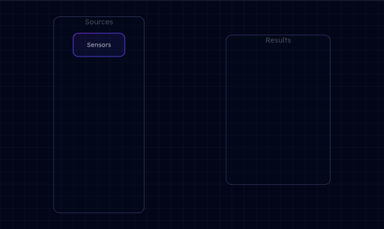
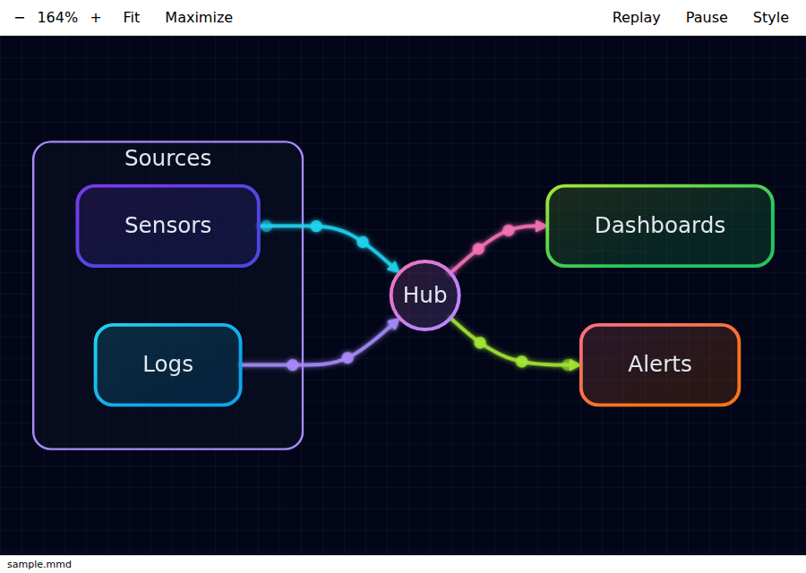
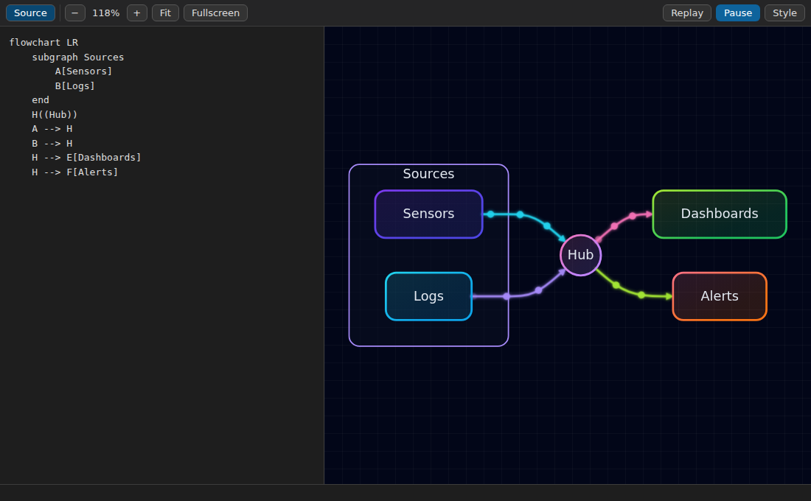

# Animated Mermaid

Turn Mermaid flowcharts into animated diagrams. Nodes pop in, edges draw themselves on with a soft glow, and particles keep flowing along the edges.



It comes in three parts:

| Folder | What it is |
| --- | --- |
| [`app/`](app) | The module (`animate-mermaid.js`) and a demo page |
| [`vscode-extension/`](vscode-extension) | A VS Code preview for `.mmd` files and Mermaid blocks in Markdown |
| [`orca-plugin/`](orca-plugin) | An Orca editor for `.mmd` files, with the source beside the diagram |

## How it works

Mermaid draws the diagram as normal. Then the module changes the SVG it made:

- **Edges draw on.** Each edge gets a dash as long as the edge (`stroke-dasharray`), and the dash slides into place (`stroke-dashoffset`).
- **Particles flow.** Small shapes follow each edge's exact path with CSS `offset-path`, looping forever.
- **Nodes pop in** in the order the arrows go, using the Web Animations API, with gradient fills and a glow filter.
- **Pan and zoom** move a wrapper around the SVG, so the animation keeps running while you move around.

## Try the demo

```sh
npm run build
npx serve dist        # or any static server; ES modules don't load from file://
```

The demo loads Mermaid from jsDelivr, so it needs internet. The VS Code and Orca versions bundle Mermaid and work offline.

## Use the module

```js
import { animateMermaid } from './animate-mermaid.js';

const source = `flowchart LR
  A[Request] --> B{Cached?}
  B -- yes --> C[Serve]
  B -- no --> D[Fetch] --> C`;

const ctl = await animateMermaid(document.querySelector('#diagram'), source, {
  theme: 'aurora',
  preset: 'build',
  particleStyle: 'comet',
});

ctl.replay();
ctl.zoomIn();
await ctl.set({ theme: 'light', nodeStyle: 'soft' });
```

Give the container a height. The diagram fits itself inside it.

Each render calls `mermaid.initialize()` with the theme's settings and `securityLevel: 'strict'`. If you pass your own Mermaid instance that other diagrams on the page also use, they get those settings too.

### Options

| Option | Values | Default |
| --- | --- | --- |
| `theme` | `aurora`, `ember`, `mono`, `ocean`, `forest`, `sunset`, `neon`, `light`, `contrast`, or your own theme object (hex colours only) | `aurora` |
| `nodeStyle` | `gradient`, `glass`, `neon`, `solid`, `outline`, `soft` | `gradient` |
| `corners` | `sharp`, `rounded`, `pill` | `rounded` |
| `curve` | `basis` (smooth), `linear` (straight), `step` | `basis` |
| `thickness` | `thin`, `normal`, `thick` | `normal` |
| `glow` | `true` / `false` | `true` |
| `preset` | `build`, `cascade`, `fade`, `slide`, `typewriter`, `pulse`, `none` | `build` |
| `particleStyle` | `dot`, `comet`, `spark`, `arrow` | `dot` |
| `particles` | particles per edge, `0` turns them off | `3` |
| `speed` | `slow`, `normal`, `fast`, or a number | `normal` |
| `flow` | dashed edges that keep moving: `off`, `slow`, `fast` | `off` |
| `loop` | replay the build-up when it ends | `false` |
| `panZoom` | Ctrl/Cmd + scroll, pinch, drag, and the `+` `-` `0` keys | `true` |
| `respectReducedMotion` | show a still diagram when the system asks for reduced motion | `true` |
| `mermaid` | your own Mermaid instance, instead of loading it from jsDelivr | |
| `mermaidUrl` | where to import Mermaid from when `mermaid` isn't given | jsDelivr, 11.17.2 |
| `fullscreenTarget` | the element that goes fullscreen | the container |
| `minZoom`, `maxZoom` | zoom limits | `0.1`, `5` |
| `maxFitZoom`, `fitPadding` | how far Fit may zoom in, and the space it leaves around the diagram | `2`, `24` |
| `onViewChange` | called with `{ zoom, fullscreen, canPan }` | |

### Controller

| Method | What it does |
| --- | --- |
| `update(source)` | Render new Mermaid source |
| `set(options)` | Change options, re-rendering only when needed |
| `play()`, `pause()`, `toggle()`, `replay()` | Playback |
| `skipToEnd()` | Jump to the finished diagram, particles still flowing |
| `setSpeed()`, `setParticles()`, `setFlow()`, `setLoop()` | Live changes |
| `zoomIn()`, `zoomOut()`, `setZoom(n)`, `fit()` | View |
| `toggleFullscreen()` | Fullscreen, or fills the page where fullscreen isn't allowed |
| `destroy()` | Remove everything |

## VS Code extension



```sh
cd vscode-extension
npm install
npm run package
code --install-extension animated-mermaid-preview-0.1.3.vsix
```

Open a `.mmd` file, or put the cursor in a ` ```mermaid ` block in Markdown, and press `Ctrl+K Alt+M`. The preview updates as you type and follows your VS Code theme. Defaults live under `animatedMermaid.*` in settings. More in [`vscode-extension/README.md`](vscode-extension/README.md).

## Orca plugin



```sh
npm install
npm run orca:sync
orca plugin install ./orca-plugin --json   # shows the access it asks for, then re-run with --approve <fingerprint>
```

`.mmd` and `.mermaid` files open in the Animated editor with the source on the left. Style choices are saved in Orca's plugin settings. More in [`orca-plugin/README.md`](orca-plugin/README.md).

## Notes

- Only tested with flowcharts (`flowchart` and `graph`).
- Mermaid is pinned to 11.17.2. Versions before 11.6 ignore the `curve` setting.
- If your system has animations turned off, the VS Code and Orca versions say so and offer an "Animate anyway" button.
- `app/animate-mermaid.js` is the only copy to edit. The VS Code and Orca folders copy it in with their sync scripts.
